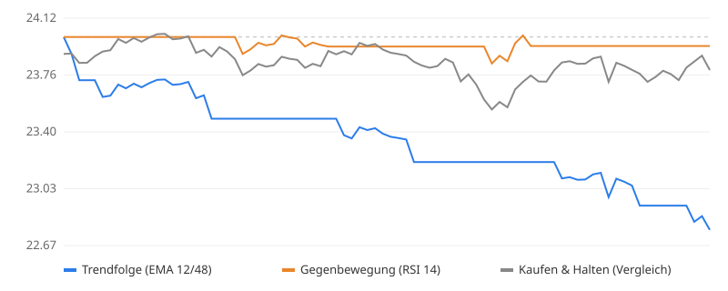

<!-- STATUS:START -->
## Aktueller Stand

**Gestartet:** 2026-10-24 20:15 UTC  
**Letztes Update:** 2026-10-28 11:45 UTC  
**Bitcoin-Preis:** 72.982,90 € (Start: 71.859,70 €)

| Strategie | Kontostand | Ergebnis | Trades | Gezahlte Gebühren | Gerade |
|---|---:|---:|---:|---:|---|
| Trendfolge (EMA 12/48) | 22,90 € | -4,59 % | 11 | 1,03 € | in Bitcoin |
| Gegenbewegung (RSI 14) | 23,94 € | -0,24 % | 4 | 0,38 € | in Euro |
| Kaufen & Halten (Vergleich) | 24,27 € | +1,11 % | 1 | 0,10 € | in Bitcoin |

Alles Spielgeld. Gebühren (0,40 %) und Slippage (0,05 %) sind pro Trade eingerechnet.
<!-- STATUS:END -->

---

# Paper-Trading-Bot (Spielgeld)

Ein Bot, der **mit virtuellen 24 €** auf **echten Bitcoin-Live-Kursen** (Kraken, BTC/EUR) handelt.
Er läuft kostenlos in der Cloud über GitHub Actions, alle 15 Minuten, auch wenn dein Handy aus ist.

- Kein Börsenkonto, kein API-Schlüssel, **kein echtes Geld**
- Gebühren (0,40 %) und Slippage (0,05 %) werden bei jedem Trade abgezogen
- Drei Konten laufen parallel, jedes mit 24 €:
  - **Trendfolge (EMA 12/48):** kauft, wenn der kurzfristige Trend über dem längerfristigen liegt, sonst Euro
  - **Gegenbewegung (RSI 14):** kauft nach starken Rückgängen, verkauft nach der Erholung
  - **Kaufen & Halten:** kauft einmal und tut dann nichts, als ehrlicher Vergleich

Die spannende Frage: Schlägt eine der aktiven Strategien nach Kosten das simple Halten?

## Einrichtung (geht auch komplett am Handy, ca. 10 Minuten)

1. **GitHub-Konto anlegen** auf github.com (kostenlos), falls du noch keins hast.
2. **Neues Repository erstellen:** oben rechts „+“ → *New repository*.
   Name z. B. `paper-bot`, Sichtbarkeit **Public** (dann sind die Cloud-Minuten unbegrenzt kostenlos;
   der Bot enthält keine Geheimnisse). Haken bei *Add a README file* setzen und *Create repository*.
3. **`bot.py` hochladen:** im Repository *Add file* → *Upload files* → `bot.py` auswählen → *Commit changes*.
4. **README ersetzen:** die Datei `README.md` öffnen → Stift-Symbol → Inhalt durch diese Datei ersetzen → *Commit changes*.
   (Optional: Der Bot schreibt seinen Status sonst einfach oben in die vorhandene README.)
5. **Zeitplan anlegen:** *Add file* → *Create new file*. Als Dateinamen genau
   `.github/workflows/bot.yml` eintippen (die Schrägstriche erzeugen die Ordner automatisch),
   den Inhalt von `bot.yml` hineinkopieren → *Commit changes*.
6. **Erster Start:** Reiter *Actions* → links *Paper-Trading-Bot* → *Run workflow*.
   Nach etwa einer Minute erscheint oben in dieser README der Stand. Danach läuft der Bot von selbst alle 15 Minuten.

Am Handy die Seite „Desktop-Version“ anfordern, falls ein Knopf in der mobilen Ansicht fehlt.

## Falls etwas nicht klappt

- **Fehler „Permission denied“ beim Speichern:** *Settings* → *Actions* → *General* → ganz unten
  *Workflow permissions* auf **Read and write permissions** stellen.
- **Läuft nicht genau alle 15 Minuten:** normal, GitHub startet geplante Läufe oft verzögert.
- **Privates Repository:** Dort gibt es nur 2.000 kostenlose Minuten im Monat. Dann in `bot.yml`
  `*/15` durch `*/30` ersetzen, damit es reicht.
- **Nach 60 Tagen ohne Aktivität** kann GitHub geplante Läufe pausieren. Ein Klick auf *Enable workflow* reicht dann.

## Dateien

| Datei | Inhalt |
|---|---|
| `bot.py` | Der Bot |
| `.github/workflows/bot.yml` | Startet den Bot alle 15 Minuten |
| `state.json` | Aktuelle Kontostände (legt der Bot selbst an) |
| `trades.csv` | Jeder einzelne Kauf und Verkauf |
| `equity.csv` | Kontostand aller Strategien nach jeder Kerze |
| `chart.svg` | Verlaufsgrafik |

## Einstellungen ändern

Oben in `bot.py`: `START_CAPITAL`, `FEE`, `SLIPPAGE`, `PAIR` (z. B. `ETHEUR`) und `INTERVAL`.
Wenn du etwas änderst, lösche `state.json`, `trades.csv` und `equity.csv`, damit der Bot neu startet.

*Spielgeld, keine Anlageberatung. Ein gutes Ergebnis über ein paar Wochen ist kein Beweis, dass eine Strategie dauerhaft funktioniert.*
